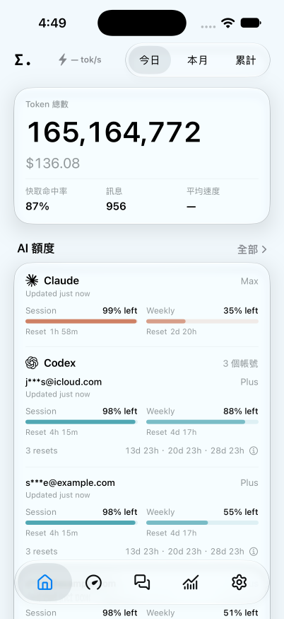
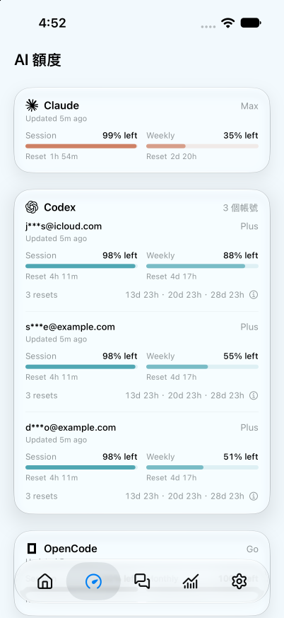

# Token Monitor for iOS

The iOS app is a read-only SwiftUI client for an existing Token Monitor Hub. It does not run collectors or store provider credentials.

## Status and source builds

The source is available here under the repository's [MIT license](../../LICENSE). It is an experimental companion app: repository inclusion and green CI do not mean an App Store or TestFlight build is available. Desktop installers do not include the iOS app. See [RELEASING.md](RELEASING.md) for distribution preparation and the remaining device, signing and Widget API checks.

## Requirements

- Xcode 26 or later
- iOS 26 or later
- Swift 6.2 (included with Xcode 26)

## Run locally

1. Clone the repository and open `apps/ios/TokenMonitor.xcodeproj` in Xcode. Use the shared **TokenMonitor** scheme. The iOS project has no third-party package dependencies and does not need `npm install` to build.
2. Choose an installed iPhone Simulator with iOS 26 or later and run. For reproducible preview data, add `--sample-data` to the Debug scheme's launch arguments; remove it to use your Hub.
3. For a physical device, select your own signing team for both the app and Widget extension. If the checked-in bundle IDs/App Group are unavailable to that team, use matching identifiers and update both entitlements plus `SharedSnapshotStore.appGroupIdentifier` (in `Shared/SharedSnapshotStore.swift`). Enable the matching App Group on both targets and Push Notifications on the app. Keep signing material outside Git.
4. In Settings → Hub, enter your Hub URL and shared secret. Start a Hub using the root [setup guide](../../README.md#multi-device-sync); a device must be able to reach it over HTTPS or the local network. `localhost` on an iPhone refers to that iPhone, not the Mac. iCloud Drive sync is not an iOS Hub endpoint.

The app does not collect usage by itself: run Token Monitor Desktop or the headless agent on the machines running your tools. Remote Live Activity updates additionally require Hub APNs configuration; ordinary foreground usage/limits and cached widgets do not.

## Screenshots

Debug sample data on an iPhone Simulator; the readings are illustrative. These are repository previews, not App Store screenshots or physical-device acceptance evidence.

<p>
  
  
</p>

## Architecture

- `Core/Models`: defensive decoders for the Hub wire contract
- `Core/Networking`: authenticated REST and Server-Sent Events client
- `Core/Security`: Keychain-backed Hub secret storage
- `Core/State`: app-level connection and data state
- `DesignSystem`: semantic tokens and reusable native surfaces
- `Features`: Overview, Limits, Sessions, Insights, and Settings
- `Widgets`: configurable Home Screen widgets, Lock Screen accessory, Live Activity, and Dynamic Island

The app reads:

- `GET /api/stats`
- `GET /api/stats/stream`
- `GET /api/history`
- `GET /api/subscriptions` (read-only shared billing records)
- `POST /api/live-activities/register` and `DELETE /api/live-activities/{activityID}` for ActivityKit push-token registration

The shared secret is sent as a bearer token and is stored in the iOS Keychain. The Hub URL is stored in user defaults.

When the Hub has APNs ActivityKit credentials configured, the app registers its Live Activity push token with the Hub. The Hub then sends remote updates while the app is suspended; without those credentials, local updates and the iOS background-refresh fallback still work.

The display language can follow the system or be set to English, Traditional Chinese, Simplified Chinese, Japanese, or Korean. Costs can be shown in USD, TWD, HKD, or CNY using the same display rates as the Desktop app; USD uses the compact `$` symbol.

## Quota presentation

The Limits screen preserves the existing Liquid Glass card for each provider group, and Overview keeps its shared quota card. Account dividers remain inside the cards. Quota readings use compact system text with monospaced digits; paired headers adapt together when space is limited, keeping the meters aligned. Fixed quota labels (Session, Weekly, Monthly, Reset), percentages, countdown units and freshness follow the desktop English presentation; navigation, settings and explanatory details remain localized. It preserves the desktop window relationships: primary Session/Weekly lanes sit side by side, lone lanes and Monthly/additional pools use a full row, Cursor windows each use a full row, and Antigravity groups pair their own rolling and weekly windows. Accessibility text sizes stack paired lanes. Supplied windows with unknown usage remain visible rather than disappearing.

Authenticated `resetCredits` data adds the available reset count and sorted expiry countdowns beneath each account. An anchored popover shows exact dates and Claude grant coverage/restrictions without opening a full-page sheet. Missing or zero available counts do not create a reset row. Quota countdowns retain days/hours or hours/minutes and refresh every minute.

WorkBuddy groups can optionally show a combined quota in Customize AI Limits. The option defaults off and applies to app cards only. A total requires every account in the group to have a fresh, healthy, finite CREDITS allowance with matching pool, region and reset metadata; missing, failed or unlimited readings suppress it. Individual accounts stay visible. Encrypted local-app sessions retain their specific status instead of asking the user to sign in again. Notion AI, Goose and CatPaw use the desktop artwork and labels.

## System surfaces and freshness

The Home Screen gallery offers Liquid Glass, Transparent and Solid widgets with the same content options; Solid also supports Lock Screen accessories. Full-color wallpaper transparency and host blur currently use an isolated private WidgetKit descriptor bridge because the public removable container background does not provide those effects in full-color mode. The bridge is guarded and falls back to WidgetKit's opaque host if its runtime contract is unavailable, but it is not a supported App Store API. Small widgets pair one dominant reading with a daily-usage bar series, a compact second quota window, or the activity grid; medium adds top-tool columns or two quota-account columns; a single quota account expands its windows. Large adds stat rows and tool/model or a height-fitting provider/account list. Explicit quota-provider selection retains every matching account rather than only the first. Plan labels align trailing and per-account freshness sits beneath the identity, matching Desktop. Multi-account email labels are masked before entering the App Group cache. Settings → Widgets previews the real widget view at each size from the latest Hub snapshot. Medium widgets offer paired or stacked quota windows and chart-first or stats-and-chart activity layouts. The activity calendar uses compact squares with Desktop's maximum-relative intensity bands and month labels below the grid; the large family shows two chronological half-year strips. Shared defaults also control reset time and text contrast. Widgets using App Default follow those preferences, while explicit per-widget overrides retain precedence. Edit Widget includes an explicit All providers choice that overrides a named app default. Choose the background kind and size on the Home Screen. Live Activity source, account, window and display choices are available inline below the appearance gallery. Lock Screen accessories show compact usage or quota readings. Live Activities provide separate Lock Screen and Dynamic Island layouts, and mark expired content as stale. In Settings → Live Activity, each side of the compact island, the presentation shown beside other activities, and the expanded and Lock Screen layouts each pair an appearance with a data source — like the desktop menu bar: an automatic AI tool (lowest remaining or most recently used) or a named one, an account, a quota window, remaining or used, a period, and all tools or only the recent one.

Widgets read the latest App Group snapshot. The app publishes while connected, and iOS may run a background refresh; WidgetKit and Background Tasks choose their own update budgets. A widget timeline is not a continuous Hub connection. Remote Live Activity updates require a Hub/Worker built from this iOS branch, APNs configuration and a successful push-token registration. Older Hub builds without `/api/live-activities/register` retain foreground updates but cannot enable remote pushes. Use a Hub/Worker built from the integrated source for remote updates. A simulator build or local Activity update does not verify remote delivery.

The icon-only native tab bar provides Overview, Limits, Sessions, Insights and Settings with Desktop vector artwork and localized accessibility names. Overview defaults to three recent interactive sessions, prioritizing running sessions, and its Sections editor can reorder or hide that block. Sessions deep links open the root tab. Settings keeps Hub first, followed by compact Live Activity and Widgets rows showing their purpose and status. Full previews and controls live in their customizer pages; Widget counts reflect WidgetKit’s current configurations, with unavailable results kept distinct from zero. A dismissible Overview invitation appears when both surfaces are unused.

The Sessions screen shows bounded today/month summaries from authenticated Hub stats, with tool, model and project search. It does not fetch conversation transcripts. Canonical titles appear only if the sending device and Hub have enabled title sync. Omitted session detail is disclosed while aggregate totals remain complete.

Codex and Claude rows show the recorded reasoning effort beside the model, including grouped conversations, without tying that setting to context/cache expiry. Senpi uses the Desktop artwork, and Muse Code follows the shared provider order. New provider accounts and quota windows remain driven by Hub data; configure their credentials in Desktop or the collector.

The app requests SSE stream v3 and applies session observation clocks to existing aggregate and device sessions without replacing their state, usage or transcript timestamps. Older Hubs retain their full-snapshot fallback. Ollama wallet balances stay monetary without an inferred quota meter, while included credits retain their reported percentage.

Untitled session rows put the tool and model on the same first line, matching the desktop fallback. The optional live speed beside the Overview brand mark uses differences in each device's timed output and timed duration between Hub frames. It is separate from the period's average speed: without consecutive timed samples it shows a dash, and an idle reading dims before clearing.

## Distribution preparation

See [RELEASING.md](RELEASING.md) for the production Widget API decision, privacy declarations, candidate/signing setup, local archive/export checks, physical-device acceptance and the separate upload/publication steps. The current private full-color Widget host bridge is still a distribution blocker; the preparation does not change its appearance or upload a build.

## Local validation and CI

From the repository root, list destinations and copy the identifier of an installed iOS 26+ iPhone Simulator:

```sh
xcodebuild -project apps/ios/TokenMonitor.xcodeproj -scheme TokenMonitor -showdestinations
# Replace SIMULATOR_UDID with an available destination from the command above.
xcodebuild -project apps/ios/TokenMonitor.xcodeproj -scheme TokenMonitor \
  -destination 'platform=iOS Simulator,id=SIMULATOR_UDID' \
  -derivedDataPath /tmp/token-monitor-ios-build CODE_SIGNING_ALLOWED=NO test

# Hub / shared / Worker regression tests require the root Node dependencies.
npm ci
npm run verify
```

[The iOS workflow](../../.github/workflows/ios.yml) runs native tests and an unsigned Release device archive for iOS or Hub/shared source changes on pull requests and pushes to `main`. It selects an available iPhone Simulator rather than requiring a particular model, checks that both privacy manifests are bundled, and retains logs and the `.xcresult` for seven days. It needs no repository secrets or Apple account. It can also be started with **Actions → iOS → Run workflow** after the workflow reaches the default branch. The existing Node CI continues to validate Hub and Worker behavior.

This workflow is a source-integration check. It does not sign, export, upload, run the distribution verifier, or establish App Store eligibility. The current private Widget host bridge is deliberately retained; the separate [distribution check](RELEASING.md#local-archive-checks) continues to reject it. No iOS upload is attached to the desktop `v*` tag workflow.

Debug builds accept `--sample-data` and `--sample-tab=overview|limits|sessions|insights|settings` for reproducible UI inspection without Hub credentials. `--sample-empty-sessions` gives a connected Hub with empty today/month session lists. `--sample-live-activity` also renders a local demonstration Activity. These options are compiled out of Release builds.

### Shared model presentation

The app reads authenticated `/api/sync/settings/modelAliases` and refreshes its cached map when `syncSettingsRevisions.modelAliases` changes. It follows desktop manual aliases and `off` / `duplicates` / `prefix` grouping for model and session lists. Grouping folds the Hub's model tokens and model costs together without changing source records or repricing them. Custom pricing stays with the collecting device and Tokscale; iOS displays the resulting Hub USD costs. Session cache estimates use the optional `promptCache` observation, expire locally, and never infer an estimate from cache-hit percentages. Source-tagged background reviews and Cursor Grok Bot activity form separate expandable groups ordered with interactive sessions by latest activity. Grok Bot identity survives model display aliases and mixed-model periods. Sessions and expanded groups scroll continuously without manual paging.


### Presentation contract checks

History calendar keys are projected into the local calendar for month labels and trend buckets; they retain their UTC representation for existing wire/heatmap projections. Optional `unpricedTokens` survives history decoding, weekly/range cost totals and model-alias folding; a zero known subtotal with missing prices is not shown as free usage. Cached Widget usage retains the Hub frame’s reporting-day key (separate from the last device freshness timestamp) across midnight (legacy caches fall back to their original source timestamp), while credits text keeps the currency balance even when its meter has a percentage.

Live Activity preview samples are isolated from operational snapshots. Starting or updating an activity requires a configured destination and genuine store data; the explicit Debug `--sample-live-activity` fixture remains separate. Sources resolve freshness from their selected quota flag and timestamp, and automatic selection prefers healthy available readings. Explicit account references take priority over provider fillers; local and remote content states enforce the same 3,500-byte budget described in the [API contract](../../docs/API.md#post-apilive-activitiesregister). The Hub reuses `sessionLive.liveActivityExpiryAt` to schedule provider-lease transitions rather than defining another lease duration.

### Desktop feature alignment

Settings → Customize → Overview controls the number of Tools, Models, Sessions and Devices independently (1–50), retaining the native defaults of 3/3/3/4. Running and waiting sessions remain visible beyond the configured preview count. These are local display preferences.

AI Limits shows source-currency Today/Month spending beneath account windows when the Hub supplies balance spend metadata. The details popover includes the other reported periods; unknown periods stay absent and zero stays visible.

Tap the live-speed reading beside the Overview brand, or open Models, to inspect model timing grouped by device. Each device retains concurrent model samples for eight seconds, uses their matched duration for its headline, and falls back to the device delta when attribution is missing or inconsistent. Device rates add across the fleet; model aliases combine matching counters for display. Missing timing has an explicit empty state.

Settings → Subscriptions reads the selected Hub's shared subscription document. Records retain their original currency and billing cadence, account email masking, anchored renewal dates, cancellation boundaries and top-up history. The monthly equivalent uses the Desktop display rates and billing rules, including this calendar month's top-ups. Edit records in Desktop. The app refreshes after authenticated subscription-version changes, keeps failures distinct from an empty list, and clears records on Hub changes. No subscription write endpoint is exposed by iOS.
