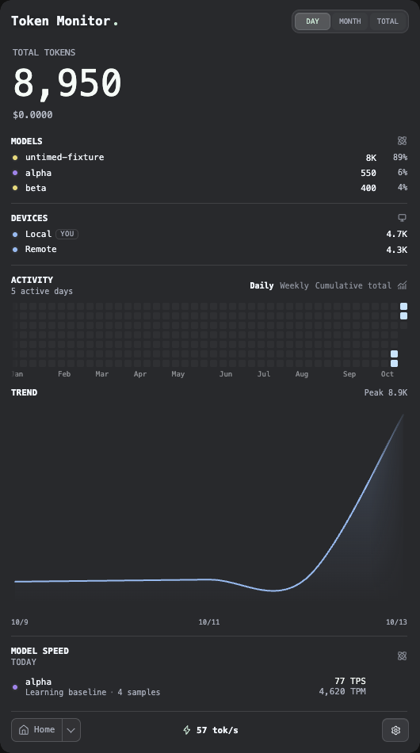

# Concurrent model live-rate integration

Date: 2026-10-13, Asia/Shanghai. Base #970: `7f231ffe651d38ffd97205e8055b3964b1bd57c2`. Code candidate: `30c9ed622bc4b98dc9b417b80cde216fe078e3bb`. Adapted from [#1016](https://github.com/Javis603/token-monitor/pull/1016), pinned at `c9d63d43a98bed7ebb937d58ae92999d1ff71c86`. This follow-up updates the existing draft [#970](https://github.com/Javis603/token-monitor/pull/970).

## Behavior and scope

A later watch tick for model B previously replaced model A's live sample even when A was still active. The renderer now retains each model's latest matched delta until its own eight-second expiry. Another update for A replaces only A's sample. Same-device speed remains duration-weighted (`sum(timedOutputTokens) / sum(timedDurationMs)`); device rates are summed across selected devices. Refreshes use the earliest contributing expiry, including when no new stats arrive. Duplicate and untimed-only snapshots do not renew measured activity. The existing dimmed last-reading presentation remains intact after all active samples expire.

Attribution must be consistent with the device delta across all models and all three timing counters. Removed, merged, regressing or incomplete model counters fall back to the device's matched delta and establish a new model baseline. Missing device timing clears the active samples and requires a fresh complete baseline.

Two small adaptations address boundaries reproduced against the original #1016 patch:

- An independently measured unattributed remainder survives a later fully attributed model tick until its own expiry. An ambiguous device fallback is replaced when attribution recovers because it can already include those same models; retaining it would double count them.
- A model attribution change without new timed device usage removes old model labels while retaining the valid device reading only until its earliest contributing expiry. It does not refresh activity or mix that fallback into recovered model samples.

Only `src/electron/renderer/tokenRatePresentation.js` changes in production, within the two live tracker functions. The matched-rate helpers and the remainder of that module are unchanged. The renderer app, styles, number animation, historical speed store/runtime and dependency manifests were compared byte-for-byte with the base. This preserves the #972 matched timing compatibility and #1025 animation changes, historical TPS calculations, source identities and persisted history. The added tests and Electron harness require no dependency change.

## Actual validation

Local source tests used Node 24.19.0, macOS arm64. The initial existing-suite and two-test reproduction used Node 25.9.0; the corrected complete reproduction and all final checks used 24.19.0. Electron UI used the lockfile's Electron 43.7.9 / Chromium 150.0.7871.250 / embedded Node 24.21.0.

| Check | Actual result |
| --- | --- |
| Existing token-rate suite before adding cases | 66 passed |
| Corrected regression suite against original #970 | 72 tests: 66 passed, 6 failed |
| Same regression suite with unadapted #1016 | 72 tests: 70 passed, 2 failed |
| Integrated token-rate suite | All 72 passed as part of focused checks |
| Token rate, Antigravity throughput, device breakdown, Edge Dock expiry | 86 passed |
| Historical speed, mixed timing, candidates, sources, ranges, lists, aliases, number animation | 125 passed |
| First full `npm run verify` | Lint passed; 7,103 passed, 1 failed, 8 skipped |
| Isolated watcher suite after that failure | 26 passed |
| Final full `npm run verify` | Lint passed; 7,104 passed, 8 skipped, 0 failed |
| New actual-Electron live-model-rate harness | Passed |
| Existing actual-Electron model-speed UI | Passed |
| Existing actual-Electron complete model list | Passed |
| Existing actual-Electron unified Sessions | Passed |
| Existing actual-Electron period-number animation | Passed |
| Diff/whitespace checks | Passed |

Counts overlap and must not be added. The six original-branch semantic failures cover staggered models, A→B→A across devices/custom expiry, retained unattributed usage, attribution-only changes, summed-model delta overflow and alias merges. In the minimal staggered case, B's update produced 10 TPS instead of the duration-weighted 20 TPS while A was still active. All these cases pass after integration. Existing and added cases also cover counter regressions, missing timing, mixed timed/untimed output, duplicate pushes and recovery without accumulating an old device fallback.

The first full suite timed out in `watcherHost.test.js` with `no event from the worker`. The isolated watcher suite and a complete rerun passed without changing watcher production code or tests. Its root cause remains unknown; the failed attempt is retained. Eight final skips cover Windows/Linux-only probes, an unavailable-probe branch on a host where the probe exists, and live Grok billing prerequisites.

The new Electron harness replays actual stats IPC through the real preload and renderer. It verifies exact cumulative model/device values and identities, duration-weighted and cross-device live TPS, unchanged revisions/expiry on duplicate pushes, partial timing coverage, and the actual eight-second timers updating the visible footer/model labels without another stats push. The historical model reading remains 77 TPS while the live footer changes independently; usage and speed history inputs remain identical. The existing harnesses also verify historical navigation/ranges, the full model list, cloud/local Sessions reconciliation, rapid period switching, Reduced Motion and restored history curves.

Harness bring-up failures were limited to fixtures: the initial page was Model rather than Home, then the fixture used breakdown-row selectors instead of the existing Home overview rows. These attempts, plus an initially incorrect alias-module test import corrected before the final reproduction, are retained under the ignored output directory. Product code was not changed to satisfy those fixture errors.

## Reproduce

Use the existing lockfile dependencies and Node >=22.15.0. No binary download or collector run is needed for these checks.

```sh
node --test tests/electron/tokenRate.test.js tests/shared/antigravityThroughput.test.js tests/electron/deviceBreakdown.test.js tests/electron/edgeDockSessionExpiry.test.js
node --test tests/electron/modelSpeedMixedTiming.test.js tests/electron/modelSpeedHistory.test.js tests/electron/modelSpeedCandidates.test.js tests/electron/modelSpeedSources.test.js tests/electron/modelSpeedRange.test.js tests/electron/modelSpeedList.test.js tests/electron/modelAliasPresentation.test.js tests/electron/modelAliasIntegration.test.js tests/electron/tokenNumberAnimation.test.js
npm run verify
TM_LIVE_RATE_VERIFY_DIR="$PWD/tmp/live-rate/electron-live" ./node_modules/.bin/electron scripts/verify-live-model-rate.js
TM_SPEED_VERIFY_DIR="$PWD/tmp/live-rate/model-speed-ui" ./node_modules/.bin/electron scripts/verify-model-speed-ui.js
TM_SPEED_VERIFY_DIR="$PWD/tmp/live-rate/model-speed-list" ./node_modules/.bin/electron scripts/verify-model-speed-list.js
TM_SESSIONS_VERIFY_DIR="$PWD/tmp/live-rate/unified-sessions" ./node_modules/.bin/electron scripts/verify-unified-sessions.js
TM_ANIMATION_VERIFY_DIR="$PWD/tmp/live-rate/period-animation" ./node_modules/.bin/electron scripts/verify-period-number-animation.js
git diff --check
```

Run the Electron harnesses sequentially. The portable [receipt](concurrent-model-live-rate-20261013.json) binds the candidate to source hashes, raw log hashes, failures, skip reasons, runtime identities and the new UI stage readings. Raw local attempts remain under ignored `tmp/live-rate-20261013/`. UI audits taken before the source commit carry the base HEAD plus the exact candidate source hashes; the documentation commit does not change those tested files.

These are controlled synthetic source/UI checks. They do not accept real-account capture, installed-app migration, signed packaging or the native Widget. The existing #945 prerequisite and #972 producer/release gates remain; #970 stays a draft.


