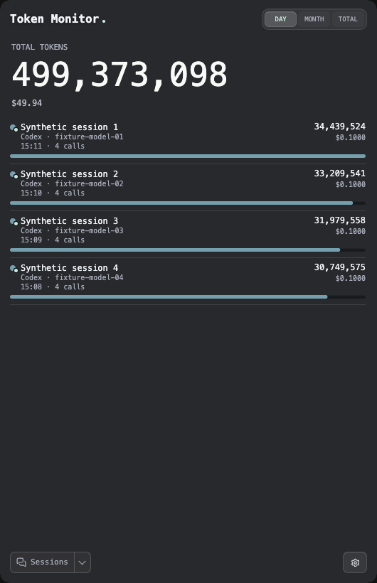
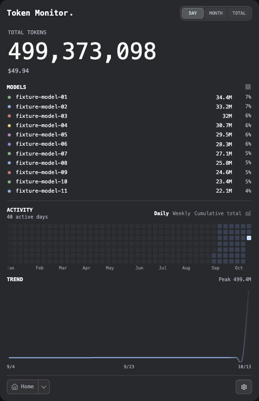

# PR #970: period-switch number animation integration

The existing unified period selection now uses the merged [#1025](https://github.com/Javis603/token-monitor/pull/1025) animation optimization. Model/Sessions breakdown readings roll as whole values during period changes; the headline retains its per-character roll with bounded interrupted layers. Live updates keep the existing character wave, and count mode and Reduced Motion retain their behavior.

## Scope and source identity

- Baseline: `231718c6fcd5527d0f0a5efefdde1e7ce6c151ee` (#970 head before this change).
- Source/test candidate: `d59673d6724b7771e8b00dbfc4f82aa1e0e397fe`. Later documentation commits leave these source files unchanged.
- Upstream merged fix: `9eb43a5567315d58e1362587d734ede595faae51`, cherry-picked with original authorship and provenance in `fdf714b`.
- #1021 (`4ab624b45aea4c95cc5c0a1047f9a1673d1fa227`) is already an ancestor of the baseline and was not transplanted again.
- `tokenNumberAnimation.js` is byte-for-byte identical to the merged upstream version: SHA-256 `4d90c2fc0126a76c980eaa4a325804b09e256456dd28955997a7ee230d7b025f`. The renderer change is the upstream one-line whole-reading option plus an updated explanatory comment.
- Statistics aggregation, token accounting, history/source modules, model ordering and dependency manifests are unchanged. Package-lock SHA-256: `ed31da62c99e47020122429fac26219ffa775ad90fb9cff2678fff260d6a4bb4`.

## Verification

`npm run verify` on Node 24.19.0: 7,106 tests, 7,098 passed, 8 environment/platform skips, zero failures. Final lint and diff checks passed. The existing `verify-model-speed-ui.js`, `verify-model-speed-list.js` and `verify-unified-sessions.js` all exited successfully against the actual Electron/preload/renderer and synthetic IPC.

The upstream animation tests are retained. Three additional deterministic regressions cover the per-place cap/fade threshold (including retaining the strongest faint layer), twenty interrupted shared-period transitions followed by a live glyph update, and Reduced Motion during a roll. They produce two failures/one pass against the baseline and three passes after integration; all 37 number-animation tests pass.

The new `verify-period-number-animation.js` verifies actual tab clicks, exact headline/model values, model ordering and row identity after rapid switches, count mode, settings-pushed and Chromium-emulated system Reduced Motion, Sessions values and page reset across Day/Month/Total, and identical history path data after returning to Day. The existing Sessions harness additionally verifies cloud/local row reconciliation and stale asynchronous responses. Screenshots below use synthetic data. Harness bring-up failures were corrected in fixtures (missing model cost attribution and the supported `on` motion preference); no product behavior was altered to satisfy them. All raw local attempts remain under the ignored test-output directory.

## Current-branch Electron measurements

Apple M4 Pro / 24 GiB, macOS Darwin 27.0.0, arm64, Electron 43.7.9 / Chromium 150.0.7871.250. Each fresh isolated profile uses the same 28-model synthetic fixture in a 530×820 content window, two seconds of warm-up, twenty Day/Month tab clicks on a nominal 150 ms schedule (ten round trips), and 1,100 ms to settle. Each version has three frame runs and three separate memory runs; version order is reversed for the middle repeat. No other test suite runs concurrently with these measurements.

| Metric | #970 baseline | #970 with #1025 |
| --- | ---: | ---: |
| rAF intervals >25 ms | 9–20 | 1 |
| p95 rAF interval, ms | 17.5–33.4 | 17.4 |
| Maximum rAF interval, ms | 49.8–67.2 | 33.1–33.7 |
| Peak added renderer + GPU working-set sum, MiB | 292.3–345.2 | 187.7–193.2 |
| Working-set sum above baseline after 20 s idle, MiB | 284.5–338.0 | 176.4–187.8 |
| Peak headline glyph elements | 43 | 29 |
| Peak glyph elements per visible breakdown reading | 21 | 2 |

Memory uses [`app.getAppMetrics()`](https://www.electronjs.org/docs/latest/api/app#appgetappmetrics) and sums renderer/GPU [`workingSetSize`](https://www.electronjs.org/docs/latest/api/structures/memory-info), in KiB converted to MiB. This sums resident working sets and can include shared pages; it is not the upstream footprint sampler, a JS heap measure, or a compositor allocation trace. Glyph counts describe DOM animation elements, not independently measured GPU allocations. rAF samples measure frame scheduling intervals, not individual compositor presentation events.

The current working-set sum remains above the initial sample after twenty idle seconds. This short experiment does not establish a leak or sustained real-device memory consumption. It does not reproduce upstream's claim of footprint returning to baseline, because the metric, input and environment differ.

## Upstream benchmark, kept separate

[#1025](https://github.com/Javis603/token-monitor/pull/1025) reports peak added renderer/GPU footprint of **776–789 MB → 393–397 MB** and >25 ms janky frames of **73 → 0–1**, using cloned real usage in its isolated Electron sandbox at 150 ms/click. Those are upstream measurements, not results from this branch. The local measurements above independently show lower transient working-set growth and fewer slow rAF intervals in this synthetic workload; their absolute values are not directly comparable to upstream.

## Reproduce

Use the lockfile dependencies and Node >=22.15.0 (verification used 24.19.0). If the environment skips dependency install scripts, run `node node_modules/electron/install.js` to populate the declared Electron runtime. No dependencies or new tooling were added.

```sh
npm ci
npm run verify
TM_ANIMATION_VERIFY_DIR="$PWD/tmp/period-animation/regression" ./node_modules/.bin/electron scripts/verify-period-number-animation.js
TM_ANIMATION_VERIFY_DIR="$PWD/tmp/period-animation/frames" TM_ANIMATION_VERIFY_MODE=frames ./node_modules/.bin/electron scripts/verify-period-number-animation.js
TM_ANIMATION_VERIFY_DIR="$PWD/tmp/period-animation/memory" TM_ANIMATION_VERIFY_MODE=memory ./node_modules/.bin/electron scripts/verify-period-number-animation.js
```

Run frame and memory commands sequentially. `TM_ANIMATION_VERIFY_ROOT` can select a separate checkout of the baseline while running this harness; both checkouts must resolve the same lockfile-matched dependencies. Repeat three times with fresh output directories. The profile, HTTP(S)-blocked Electron session and IPC responses are isolated fixtures, with no collector, account, installed-app replacement or native widget involved.

[Portable measurements and raw frame/memory samples](period-number-animation-20261013.json) include commits, source hashes, process/version identities, click timestamps and checks. [Harness](../../scripts/verify-period-number-animation.js).




