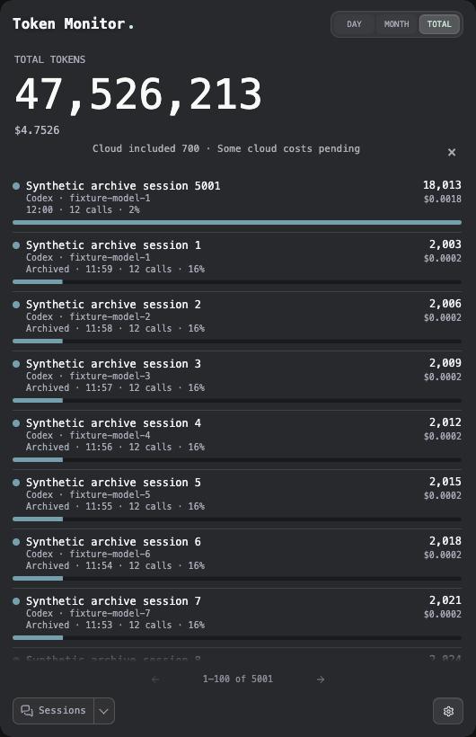

# PR #1031 evaluation and archive-only integration

Large SQLite session archives previously retained every raw JSON row while parsing the same data into the accepted archive. This follow-up to [#970](https://github.com/Javis603/token-monitor/pull/970) integrates only the streamed archive reader and its failure-recovery tests from [#1031](https://github.com/Javis603/token-monitor/pull/1031). The two-entry TOTAL cache package remains an independent evaluation: its process memory benefit varied substantially, while an older retained snapshot took longer to read.

## Source and scope

The fixed baseline is `7941d74efa6ab1515298230d528778014dc2e2e7`, including the existing #1025 animation work and the concurrent-model live-rate follow-up. During the first comparison, another executor advanced #970 from `7f231ffe` to that baseline. Those new commits were preserved, and the affected comparison was excluded and repeated using a detached baseline.

The supplied #1031 HEAD was `9cc73221e864f3bd2e8f70e3f26c184e1710791b`. Its reviewed follow-up, `7da93b9b0fe2ab7bd762ced8f6500fb3c81c37d3`, also pins the normalization/activity clock when recreating an evicted historical snapshot. Both commits were evaluated together on #970 at local candidate `d6ce1eb56cb6fa23589554fe4f6ce67992634fac`. The combined portable Hub closure required regenerated metadata in that evaluation; it is outside the selected integration.

Selected source commit: `e450594` (`perf(archive): stream SQLite session reads without partial publication`). The reader and archive tests are byte-for-byte identical to the original upstream commit. Original authorship and the upstream commit identity are retained. Harness commit: `71bf61b28f548a64df36bf89970fa5d9aae1394f`. Later documentation commits leave these tested files unchanged.

Production scope is one module, `src/shared/usage/sessionUsageArchiveStore.js`, plus its architecture paragraph:

- Read session rows through SQLite's iterator, retaining the parsed archive rather than an additional array of raw JSON rows. Small metadata queries remain eager.
- Close the cursor in `finally`, including when stepping the iterator throws.
- Publish a full replacement archive only after its scan succeeds. Stage incremental parsed changes before applying them, preserving the previously accepted archive and revision after an interrupted scan.
- Preserve revision catch-up, concurrent-writer recovery, malformed-row handling and legacy migration behavior.

TOTAL cache capacity, eight historical snapshot IDs, token arithmetic, cloud accounting, current model rates, renderer/number animation, dependencies and portable Hub/Worker files are unchanged from the baseline. No cache or historical-clock patch is transplanted. The archive store is outside the portable Hub source closure, so this selected change requires no Hub revision increment.

## Matched measurements

Apple M4 Pro / 24 GiB, macOS Darwin 27.0.0 arm64; lockfile Electron 43.7.9 / Chromium 150.0.7871.250 / embedded Node 24.21.0. Source tests used Node 24.19.0. Each run uses a fresh private Electron profile, the same SQLite fixture with 5,000 archived sessions, one live fixture session, ten updates and a 530×820 content window. No test suite runs concurrently with performance measurement, and no forced GC is used.

The harness uses native SQLite, the actual archive store/usage transform, extracted actual main-process snapshot and cloud-presentation functions, and the real preload/renderer/IPC. Collection is replaced by a fixture worker. It does not run the production collector, native watcher, real-account scanner, installed app or native Widget. The upstream PR supplied its benchmark procedure and aggregate results but no reusable benchmark script; its regressions were reused, and this matched local harness implements the reported workload shape with these explicit boundaries.

Memory runs use baseline → candidate → candidate → baseline. Separate latency runs use baseline → candidate → candidate → baseline → baseline → candidate. Eleven published revisions have identical period and session fingerprints across every qualified run, including exact token/model totals and existing cost presentation precision. Independent expected token arithmetic is also checked. Historical reads validate all eight retained IDs against their original fingerprints, and reject expired IDs.

| Selected archive-only metric | Fixed #970 | Streamed reader |
| --- | ---: | ---: |
| Worker heap used immediately after archive load, MiB (memory runs) | 18.35–18.63 | 12.14–12.21 |
| Archive load, ms (memory runs) | 96.31–96.48 | 100.09–100.41 |
| Raw JSON rows held in an eager array | 5,000 | 0 |
| Older retained snapshot IPC median, ms (latency runs) | 22.40–22.70 | 22.25–22.75 |
| Current snapshot IPC median, ms (latency runs) | 21.80–22.60 | 22.50–22.70 |
| Period-click handler median, ms | 8.5–8.8 | 8.8–9.0 |
| Period-click handler p95, ms | 107.7–114.7 | 111.0–116.4 |
| rAF interval p95, ms | 18.3–18.5 | 18.1–18.4 |
| rAF intervals over 25 ms | 9–10 | 8–9 |

The paired archive-load heap reduction is **6.14–6.49 MiB**, with approximately four additional milliseconds to load the fixture. Historical reads and period switching show no material regression in these runs. This is a bounded benefit in archive loading, not a claim of sustained application RSS savings.

| Archive-only process working-set sum, MiB | Baseline 1 | Stream 2 | Stream 3 | Baseline 4 |
| --- | ---: | ---: | ---: | ---: |
| Home | 621.52 | 627.61 | 625.80 | 618.64 |
| TOTAL after updates | 976.72 | 979.48 | 965.22 | 973.77 |
| After leaving TOTAL | 726.04 | 875.48 | 726.26 | 881.29 |

Process memory did not show a stable direction. Measurements sum [`app.getAppMetrics()`](https://www.electronjs.org/docs/latest/api/app#appgetappmetrics) resident [`workingSetSize`](https://www.electronjs.org/docs/latest/api/structures/memory-info) values for main, renderer, GPU and utility processes, converting KiB to MiB. Shared resident pages can be counted more than once. This is not private footprint. The worker's [`process.memoryUsage()`](https://nodejs.org/docs/latest-v24.x/api/process.html#processmemoryusage) heap fields describe its current thread; its RSS field describes the entire containing process. rAF describes scheduling intervals, not compositor presentation.

## Why the complete cache package is deferred

The full corrected upstream package passed focused source and synthetic snapshot checks. Its two-entry caches correctly retain the eight snapshot identities and enough immutable input to rebuild an evicted projection. Historical clocks remain stable when wall time advances. Cache clearing on `startMode` concerns source/Hub mode reconfiguration; it is not triggered by DAY/MONTH/TOTAL tab selection.

| Full package memory comparison, MiB | Baseline 1 | Full 2 | Full 3 | Baseline 4 |
| --- | ---: | ---: | ---: | ---: |
| TOTAL after updates | 976.06 | 976.23 | 782.75 | 977.56 |
| After leaving TOTAL | 724.81 | 716.45 | 590.20 | 728.16 |

The first pair has effectively no TOTAL RSS reduction; the reversed pair reduces it by 194.81 MiB. After leaving TOTAL, reductions are 8.36 and 137.95 MiB. Three separate latency runs per version give **22.5–22.7 ms → 59.25–60.9 ms** for older retained snapshot reads, while current reads and normal period switching remain close. The older-read protocol accesses three newer snapshots before each timed old read, exposing cache eviction in the proposed package. It is not a cold-cache benchmark for the existing eight-result cache.

[#1031](https://github.com/Javis603/token-monitor/pull/1031) reports approximately 149–290 MiB lower TOTAL RSS, 90–204 MiB after leaving TOTAL, and 22 → 44 ms older reads for its original synthetic comparison. These remain upstream results. The PR's historical-clock follow-up was not accompanied by a rerun of that benchmark. Its values are not treated as demonstrated real-account or sustained-device benefits here. The full cache package is withheld because this local experiment does not establish a repeatable RSS benefit sufficient to justify its historical-read cost.

## Verification and review

The upstream focused regressions were run before and after the full package: original baseline 90 passed / 21 failed, full package 111 passed. Some original failures concern APIs introduced by the cache patch, so they are not all reproduced user-facing bugs. The combined snapshot/archive/cloud/model-speed/Hub checks passed in all seven CI timezones on the full evaluation candidate.

The selected store suite adds nine cases, including injected real SQLite iterator failures, full and incremental scan recovery, cursor cleanup, read-only retries, malformed rows, failed reload retention and concurrent WAL writers. The accepted archive is checked by identity/content before retry, rather than counting a partial successful scan as acceptance.

Final selected `npm run verify`: **7,121 tests, 7,113 passed, 8 skipped, zero failures; lint passed**. Fixed-baseline verification: 7,104 passed, 8 skipped, zero failures. Previous full-package and selected verification attempts timed out in `watcherHost.test.js` (`new roots not watched`); isolated watcher suites and a final complete rerun passed without watcher source/test changes. A similar watcher timeout was recorded in the preceding model-rate integration. The cause remains unknown, and the failed logs are retained and hashed in the receipt.

The final actual-Electron regression verifies DAY/MONTH/TOTAL totals, archive/local/cloud presentation, eight historical revisions, expired IDs, Sessions pagination/reset and title visibility. Existing unified Sessions, concurrent model-rate and period-animation harnesses are rerun on the selected tree. Focused archive/snapshot/cloud/model-speed/Hub checks passed all 189 cases in each of the seven CI timezones. Their actual results, source hashes, runtime identities, raw process/frame/IPC samples and failed log hashes are in the [portable receipt](total-memory-20261013.json). Counts overlap and should not be added.

Independent standards review found no documented-standard breaches in the full source package, including generated Hub/Worker consistency. Independent spec review found no source contract/scope violations; it did not qualify performance. The selected reader/tests are a byte-identical subset of that reviewed source. The root review corrected the reviewer's statement about tab-triggered cache clearing, and makes the narrower integration decision from the matched measurements.

Early measurement attempts are excluded where the baseline moved, live fixture headers omitted counters, or an oracle expected unrounded costs instead of the existing intermediate/presentation precision. Correcting those fixtures did not change product arithmetic. The original attempts remain available locally; exclusion reasons and log hashes accompany the successful results.

## Reproduce

Use Node >=22.15.0 and the existing lockfile dependencies. Run all Electron measurements sequentially with fresh output directories. Seed a fresh fixture on the measurement date; its clock is local noon. Compare checkouts with the same dependencies and use the same harness for both.

```sh
npm ci
npm run verify
TM_TOTAL_VERIFY_DIR="$PWD/tmp/total-memory/fixture" node scripts/verify-total-memory.js --seed
TM_TOTAL_VERIFY_ARCHIVE="$PWD/tmp/total-memory/fixture/session-usage-archive.sqlite" \
  TM_TOTAL_VERIFY_DIR="$PWD/tmp/total-memory/regression" \
  ./node_modules/.bin/electron scripts/verify-total-memory.js
TM_TOTAL_VERIFY_ARCHIVE="$PWD/tmp/total-memory/fixture/session-usage-archive.sqlite" \
  TM_TOTAL_VERIFY_DIR="$PWD/tmp/total-memory/memory-01" TM_TOTAL_VERIFY_MODE=memory \
  ./node_modules/.bin/electron scripts/verify-total-memory.js
TM_TOTAL_VERIFY_ARCHIVE="$PWD/tmp/total-memory/fixture/session-usage-archive.sqlite" \
  TM_TOTAL_VERIFY_DIR="$PWD/tmp/total-memory/latency-01" TM_TOTAL_VERIFY_MODE=latency \
  ./node_modules/.bin/electron scripts/verify-total-memory.js
TM_SESSIONS_VERIFY_DIR="$PWD/tmp/total-memory/unified-sessions" ./node_modules/.bin/electron scripts/verify-unified-sessions.js
TM_LIVE_RATE_VERIFY_DIR="$PWD/tmp/total-memory/live-rate" ./node_modules/.bin/electron scripts/verify-live-model-rate.js
TM_ANIMATION_VERIFY_DIR="$PWD/tmp/total-memory/animation" ./node_modules/.bin/electron scripts/verify-period-number-animation.js
npm run update:hub-build
git diff --check
```

Set `TM_TOTAL_VERIFY_ROOT` to an absolute checkout of the fixed baseline or full evaluation candidate to run the same harness against that source. The harness binds HEAD, relevant source hashes, fixture hash and runtime versions and rejects source changes during a run. The portable receipt preserves the original full-package harness identity; the final harness adds the archive-store hash and a current-date seed without changing the workload.

These checks establish a repeatable reduction in synthetic archive-load heap and preserve the tested data/interaction contracts. Real-account capture, installed-app migration, signed packaging, native Widget, Windows/Linux UI and stable everyday RSS remain outside this acceptance. #970 retains its draft and existing prerequisite/release gates.


