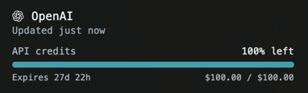

# OpenAI API Credits

Show your actual OpenAI Platform API credit balance in Token Monitor’s native Limits page.



Interface example. Balance and expiry depend on your account.

## Features

- A sortable **OpenAI** entry with native Codex artwork and colors, including your color overrides.
- A progress bar and balance, or balance only.
- Remaining amounts and UTC expiry times for multiple usable grants with different expiry dates.
- Manual session credentials, verified and managed by the App.
- Interface, README and changelog in English, Traditional Chinese, Simplified Chinese, Japanese, Korean and Brazilian Portuguese.

This plugin shows API credits, not ChatGPT message limits or a Costs-based estimate.

## Compatibility and installation

Requires **Token Monitor 0.88.0 or later** (`tmApi: 1`) for native quota modules, credential verification and presentation. Version 0.87.x is unsupported; update the App before importing this plugin.

In **Settings → Plugins**, import the `.tmplugin` file or this complete source folder, review it and enable it. Then select and expand **OpenAI** in **AI tool quota**. Installation does not configure an account automatically.

## Setup

1. Copy the billing URL in the OpenAI settings into your usual browser. Sign in and select your organization.
2. Open DevTools (**F12** or **Cmd+Opt+I**) → **Network**, reload and select `credit_grants`.
3. In **Headers → Request Headers**, copy `Authorization` into **Platform session token** and `OpenAI-Organization` into **Organization ID**. The token can include the `Bearer` prefix. Do not use an ordinary API key, Cookie header or ChatGPT/Codex token.
4. Save the credentials. The App verifies them and folds the editor on success. Return to **Limits** to view your balance.

Use **Change credentials** to replace saved values; secrets are never filled back into the inputs. If the session expires, obtain fresh credentials. Never share them in chat or screenshots. No embedded login browser is used.

## Display and refresh

The balance comes directly from the service. The bar compares it with the total allowance of grants that are currently usable and still have remaining credit. An available $100 grant and an inactive $0/$24 grant display **$100 / $100**. This is the current usable pool, not monthly or lifetime spending. The denominator changes as grants expire or are depleted.

If the grants do not reliably explain the balance, only the balance is shown. Zero remains zero. The expiry below the bar is the earliest known expiry of usable credit. A tooltip lists individual remaining amounts only when multiple usable grants have different expiry times; it does not repeat historical totals or claim expired credit was spent. With more than 12 usable grants, the breakdown is omitted rather than truncated.

Refresh follows the App’s Limits interval, adaptive setting and visibility demand. Saving credentials performs a separate verification. The plugin has no polling timer. Choose **Balance only** in settings if preferred.

## Data and access

The App stores credentials in a private, unencrypted file at `plugin-credentials/openai-api-credit/credits.json` under its user data directory, separate from plugin code and ordinary preferences. The backend sends them to `https://api.openai.com/v1/dashboard/billing/credit_grants` through the App’s proxy-aware transport. This undocumented endpoint and session credentials may change or expire. On Windows, access follows inherited folder permissions; the App does not set an owner-only ACL.

Only normalized quota data reaches the interface. The plugin does not read other apps’ login files, open a login window or send analytics. Plugins are trusted local code, not isolated from the operating-system user’s files. This module currently integrates with native Limits and settings.

## Updates

Import a newer package through **Settings → Plugins** and review the update. Nothing installs automatically. See [CHANGELOG](CHANGELOG.md).

To build from the repository root, choose an output path that does not already exist:

```sh
node scripts/build-plugin-package.js plugins/openai-api-credit ./openai-api-credit-0.1.0.tmplugin
```

## License

[MIT](LICENSE).
